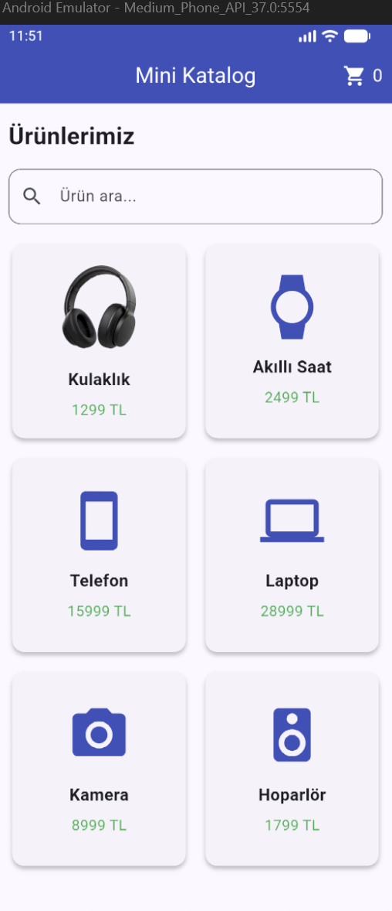
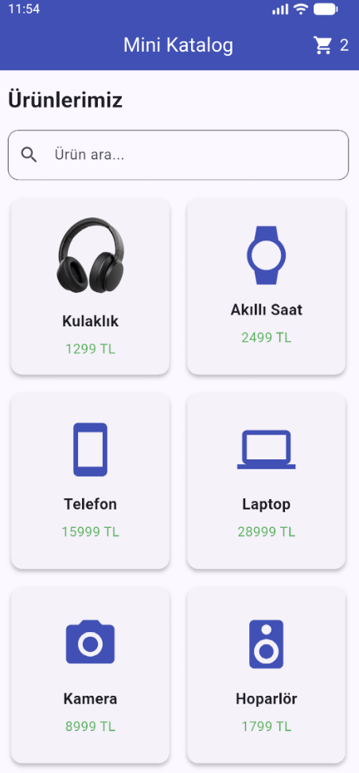

# Mini Katalog

## Proje Hakkında

Mini Katalog, Flutter kullanılarak geliştirilmiş basit bir mobil ürün katalog uygulamasıdır. Kullanıcılar ürünleri listeleyebilir, ürün detaylarını inceleyebilir, ürün arayabilir ve sepete ürün ekleyebilir.

## Özellikler

- GridView ile ürün listeleme
- Ürün detay sayfası
- Ürün adına göre arama
- Sepete ürün ekleme ve sepet sayacı
- Favorilere ürün ekleme
- Ürün görseli gösterimi
- JSON verileriyle ürün modeli oluşturma
- Sayfalar arası geçiş

## Kullanılan Teknolojiler

- Flutter
- Dart
- Android Emulator
- Visual Studio Code

## Projeyi Çalıştırma

1. Projeyi bilgisayarınıza indirin.
2. Proje klasörünü Visual Studio Code ile açın.
3. Terminalde aşağıdaki komutları çalıştırın:

```bash
flutter pub get
flutter run
```

## Ekran Görüntüleri

### Ana Sayfa


### Ürün Detay Sayfası


### Sepet Sayacı



## Proje Yapısı

- `lib/main.dart`: Uygulamanın ana kodları
- `assets/images/`: Ürün görselleri
- `screenshots/`: Uygulama ekran görüntüleri

## Flutter Sürümü

- Flutter 3.47.7 (Stable)
- Dart 3.13.5
